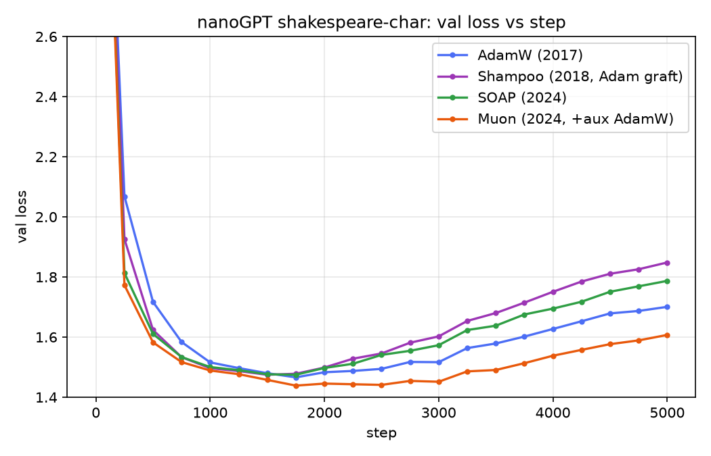
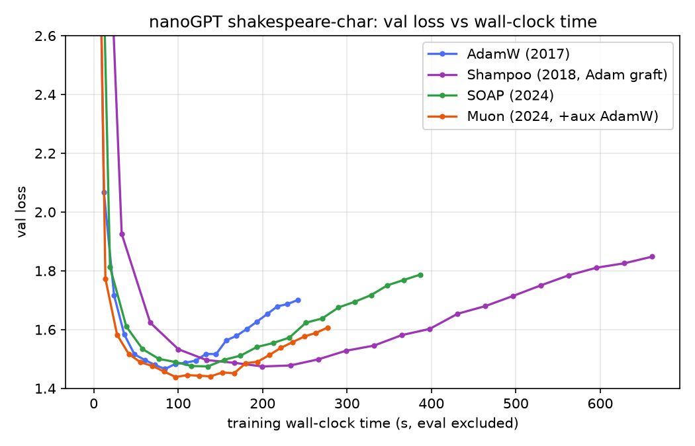
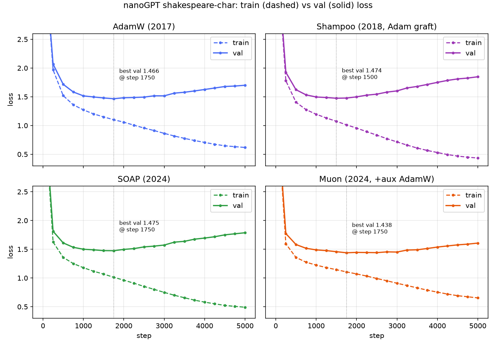

# nanoGPT optimizer comparison: AdamW vs Shampoo vs SOAP vs Muon

nanoGPT shakespeare-char(6 layer, 384 dim, 10.65M params)를 같은 설정으로 5000 step 학습하면서
네 가지 옵티마이저를 발표 순서대로 비교한 실험: AdamW(2017) → Shampoo(2018) → SOAP(2024.9) → Muon(2024.10).
단일 RTX 5060(8GB), 2026-10-31.

**결과와 요약은 [results/README.md](results/README.md)** 에 있다.





| run | best val loss (step) | ms/step |
|---|---|---|
| AdamW (2017) | 1.4659 (1750) | 48.5 |
| Shampoo (2018, Adam graft) | 1.4745 (1500) | 132.8 |
| SOAP (2024) | 1.4746 (1750) | 77.6 |
| Muon (2024, +aux AdamW) | **1.4385** (1750) | 55.7 |

## 구성

- `scripts/train_exp.py` — nanoGPT `train.py`에 `--optimizer_name=adamw|shampoo|soap|muon`, 그룹별 lr 스케줄, CSV 로깅을 덧붙인 버전 (nanoGPT와 같은 MIT 라이선스)
- `scripts/run_all.sh`, `scripts/run_extra.sh` — AdamW/Muon, SOAP/Shampoo 실행 (30 step 스모크 테스트 포함)
- `scripts/analyze.py`, `scripts/plot_train_val.py`, `scripts/gen_samples.sh` — 그래프·표·500자 생성 샘플
- `results/` — CSV 로그, 그래프, 표, 샘플, 설정과 요약

checkpoint(합쳐 686MB)와 외부 리포는 포함하지 않았다.

## 재현

작업 폴더(예: `~/research/nanogpt-muon`)에 아래 외부 리포를 clone하고 `.venv`를 만든다.
스크립트는 이 폴더 구조를 가정한다.

| 리포 | 커밋 |
|---|---|
| https://github.com/karpathy/nanoGPT | 3adf61e |
| https://github.com/facebookresearch/optimizers | 2837ffc |
| https://github.com/nikhilvyas/SOAP | a1e5535 |
| https://github.com/KellerJordan/Muon | f98f1ca |

```bash
uv venv --python 3.12 .venv
uv pip install --python .venv/bin/python torch --index-url https://download.pytorch.org/whl/cu128   # Blackwell(sm_120)용
uv pip install --python .venv/bin/python numpy requests tiktoken matplotlib pandas ./Muon
cp SOAP/soap.py nanoGPT/soap.py          # SOAP README가 안내하는 방식
cp scripts/train_exp.py nanoGPT/
.venv/bin/python nanoGPT/data/shakespeare_char/prepare.py
./run_all.sh      # AdamW, Muon   (~6분/run)
./run_extra.sh    # SOAP, Shampoo (PYTHONPATH=fb_optimizers, ~7분 / ~12분)
.venv/bin/python analyze.py && .venv/bin/python plot_train_val.py && ./gen_samples.sh
```

torch 2.11.0+cu128, Python 3.12, 드라이버 595.99.
